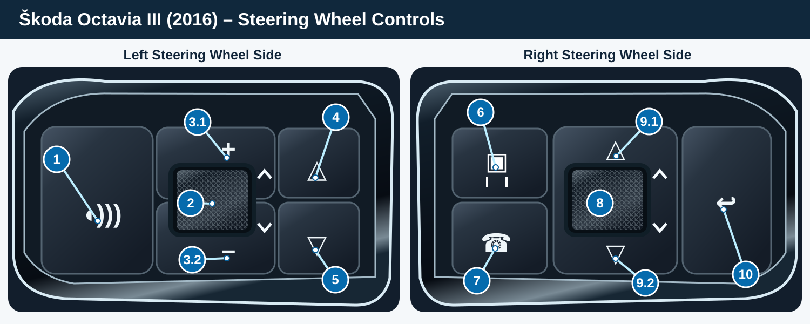

# Physical steering-wheel and head-unit input map — Škoda MU1440

**Updated 22 October 2026.** These are *observed on the fitted reference vehicle* unless marked otherwise. The manufacturer’s symbolic LEFT/RIGHT names do **not** reliably describe the physical wheel side on this car. Presses (`updateKey2`) and detents (`updateEncoder2`) are separate event families. This page is the current public mapping, superseding the older warnings-only conclusions; the dated raw-record analysis remains [available here](../research/keypanel/MU1440_F902_FIVE_INT_ENCODER_CAPTURE_2026-10-11.md).

## Illustrated physical reference — Škoda Octavia III (2016)

[Open the full-size steering-wheel control diagram](assets/MU1440_OCTAVIA_III_2016_STEERING_WHEEL_CONTROL_MAP.svg).

The illustrated reference follows **the owner's photographed 2016 Octavia III wheel**, not a later Octavia IV or a generic Škoda/VW layout. The drawing is a **stylized visual aid**, not an OEM component drawing. The numbers below identify physical controls and gestures; **they are not DSI key IDs**. In particular, **2/8 are roller *pushes*** and **3.1/3.2 and 9.1/9.2 are roller *rotations***, which arrive on a different DSI callback. The labels **+ / −** are wheel direction markings, not separately verified pushbuttons. Symbolic OEM LEFT/RIGHT naming does not override the measured physical positions.

## Physically correlated controls

| Ref. | Symbol | Physical input (2016 wheel) | Observed DSI signal | Evidence / caution |
| :---: | :---: | --- | --- | --- |
| **1** | 🗣 | Left voice/PTT button | `updateKey2`: `KBD=4, KEY=50`; `KST 1→0` | Vehicle-correlated; exact label is PTT/voice, not necessarily a particular phone voice assistant |
| **2** | ● | **Left roller push (center click)** | `updateKey2`: `4/44`; `1→0` | Measured **push**, separate from rotation; OEM symbol calls KEY44 `ROLLER_RIGHT` |
| **3.1** | ＋ ↑ | **Left roller rotate upward** (volume + marking) | `updateEncoder2(4,44,+1,0,1)` | Measured five-int encoder tuple; **not** a dedicated pushbutton |
| **3.2** | − ↓ | **Left roller rotate downward** (volume − marking) | `updateEncoder2(4,44,-1,0,1)` | Measured five-int encoder tuple; OEM volume function is contextual and not itself the raw ID |
| **4** | △ | Left upper arrow button | `updateKey2`: `4/46`; `1→0` | Vehicle-correlated to manual action sequence; symbolic `ARROW_A_UP` |
| **5** | ▽ | Left lower arrow button | `updateKey2`: `4/47`; `1→0` | Vehicle-correlated to manual action sequence; symbolic `ARROW_A_DOWN` |
| **6** | 🚘 | Right driver-assistance button | **Not yet physically mapped** | OEM assistance menu observed; no defensible `KBD/KEY` tuple from this capture. No `HK` text is not proof of no input |
| **7** | ☎ | Right telephone button | `updateKey2`: `4/53`; `1→0` | Vehicle-correlated; symbolic OEM constant `HOOK`, actual action depends on phone state |
| **8** | ● | **Right roller push (center click)** | `updateKey2`: `KBD=4, KEY=40`; short `1→0`; long `1→3→4→5→0` | Vehicle-correlated; symbolic OEM name `ROLLER_LEFT` is **not** physical left side |
| **9.1** | ↑ | **Right roller rotate upward** (scroll up) | `updateEncoder2(4,40,+1,0,1)` | Three directly decoded five-int records in annotated up direction; not proven AirPlay semantic zoom |
| **9.2** | ↓ | **Right roller rotate downward** (scroll down) | `updateEncoder2(4,40,-1,0,1)` | Three directly decoded five-int records in annotated down direction; separate from KEY40 push |
| **10** | ↩ | Right Back/menu-return button | `updateKey2`: `4/41`; short `1→0`; long `1→3→4→5→0` | Vehicle-correlated; **not** the separately unresolved physical VIEW button |

**Diagram/measurement scope:** The numbers and icons refer only to the fitted photographed 2016 wheel. The up/down signs around the rollers mark rotary motion; they do not prove dedicated button events. Native volume/phone/menu behavior may depend on HU/VC state. No measured `KBD/KEY` has been assigned to Assist or VIEW; do not import assumptions from later-model steering wheels.

**Important:** `KBD4/KEY38` and `KEY39` are OEM symbolic UP/DOWN *key* IDs and a public third-party 790 adapter uses them for semantic actions; neither was emitted as an `HK Received` event during our measured right-wheel detents. Do not invent KEY38/39 messages or globally swallow stock rotary callbacks. `KEY40` as a press and encoder ID 40 as a rotation are different DSI message types.

## Main head unit / physical button area

| Physical input | Measured on this reference unit | Confidence |
| --- | --- | --- |
| HOME | `updateKey2`: `KBD=13 KEY=116`, short `1→0`; a ~5.5-second hold also logged only `1→0` | Vehicle log + operator note |
| MENU | `updateKey2`: `KBD=13 KEY=78`, `1→0` | Vehicle log + operator note |
| NAV, CAR, RADIO, MEDIA, APP/SmartLink, PHONE, SETUP and any other fitted hardkeys | **Not individually mapped in the published capture** | Unknown; don't derive numbers from a generic VW/QEMU target |
| Main head-unit rotary control(s): turn +/− / push (where fitted) | **No independently correlated five-int tuple in this public dataset** | Unknown; distinguish rotary and press events |

### Published cross-platform lead — not measured on our MU1440

The open-source [lprot/MIB-Tools `configurationmanagerDecoder.py`](https://github.com/lprot/MIB-Tools/blob/master/configurationmanagerDecoder.py) independently labels keyboard `0x01` as console, `0x04` as steering wheel and `0x0D` as head-unit buttons. Its published key mapping (credited there to [mrfixpl's original public toolbox discussion](https://github.com/olli991/mib-std2-pq-zr-toolbox/issues/7)) gives useful candidate numeric **DSI key names**:

| Public MIB-Tools candidate key | Symbolic action | Public MIB-Tools candidate key | Symbolic action |
| ---: | --- | ---: | --- |
| 1 | MEDIA | 3 | PHONE/TEL |
| 4 | NAV | 6 | CAR |
| 7 | SETUP/SETTING | 15 | RADIO/BAND/TUNER |
| 16 | RIGHT KNOB/DDS | 17 | VOL |
| 78 | MENU | 104 | MAP |
| 108 | SELECT | 114 | APP/SMARTPHONE |
| 116 | HOME | | |

**Evidence boundary:** this decoder explicitly discusses MIB STD2 PQ/ZR resource variants and even documents firmware-dependent APP remapping. The symbolic values are neither a directly captured MU1440 `KBD/KEY/KST` record nor a guaranteed physical pin/ID for a differently fitted front panel. Only HOME `13/116` and MENU `13/78` from our table above are independently correlated by our reference-unit capture. The other numbers are excellent candidates for read-only event-by-event verification, *not* a justification for remapping an unknown button or substituting a STD2 configuration file into MHI2. The event IDs such as “NAV pressed” from a higher-level event table are also not raw KEY IDs.

The firmware also contains higher-level hardkey constants such as smartphone/App-Connect ID 114 and mute ID 88. Those are **static API findings, not a measurement** that a particular physical head-unit button has the same `KBD/KEY` tuple. Do not turn symbol existence into a physical assignment.

## Unresolved steering-wheel controls

| Physical control | Known OEM effect | Raw route still required |
| --- | --- | --- |
| Right **VIEW** button, short/hold | OEM cluster view selector / stock preset-selection menu | Exact input tuple and whether it reaches the MHI2 KeyPanel DSI, a separate VC-only route, or another consumer are **unknown**. Do not guess KEY58/59 or steal the stock long press |
| Right assistance button | OEM assistance-systems action | Not visible as `HK` in the earlier sampled DebugSPI text route; **not evidence of no input** |
| Remaining fitted wheel variants/keys | Varies by equipment and model | No universal Škoda/SEAT/VW key ID claimed |

### DSI event notation and OEM constants

`KBD_MFW=4` on this target. An `HK Received: KBD[k] KEY[n] KST[s]` report is a **key** event. A wheel detent belongs to `updateEncoder2(keyboard,encoderId,signedIncrement,extra,validity)`; the observed five-int vectors above were recovered from separately recorded, typed `f9 02` inner DebugSPI data, not from the `HK` text channel. The observed structured record tag `0x002e` is **not** independently proved to be an OEM service method number.

Known symbolic MFW key constants recovered for this exact firmware, **not physical assignments without a matched capture**:

| Key ID | OEM symbolic constant | Key ID | OEM symbolic constant |
| ---: | --- | ---: | --- |
| 35 | MENU | 36 / 37 | ARROW_RIGHT / ARROW_LEFT |
| 38 / 39 | UP / DOWN | 40 / 41 | ROLLER_LEFT / CANCEL |
| 42 / 43 | VOLUME_UP / VOLUME_DOWN | 44 / 45 | ROLLER_RIGHT / AUDIOSOURCE |
| 46 / 47 | ARROW_A_UP / ARROW_A_DOWN | 48 / 49 | ARROW_B_UP / ARROW_B_DOWN |
| 50 / 51 | PTT_ON / PTT_CANCEL | 52 / 53 | INFO / HOOK |
| 54 / 55 | HANGUP / OFFHOOK | 56 / 57 | LIGHT / MUTE |
| 58 / 59 / 60 | JOKER1 / JOKER2 / INIT | 99 / 100 | SIDEMENULEFT / SIDEMENURIGHT |

KST values: `0` released; `1` pressed; `2` double-pressed; `3/4/5` successive long-press stages; `6` approached; `7` abandoned; `8` moved. Individual gestures need their own actual on-unit proof; a possible key constant is not a confirmed OEM behavior.

## Can you help complete the mapping?

We welcome **sanitized, read-only** observations from compatible Škoda, VW, SEAT and CUPRA owners, especially for **VIEW and Assist, remaining head-unit hardkeys, and front rotary encoders**. Please share exact firmware train/MU, fitted cluster, physical label and short/long/turn direction, `KBD/KEY/KST` *or* complete `updateEncoder2` values if actually observed, and the normal OEM visible response. Indicate whether data is *observed* or merely symbolic/static. Do **not** upload original firmware/JARs, full raw log/capture, vehicle identifiers, VIN, contacts, private nav/media or location-bearing images. A missing DebugSPI `HK` may mean only that the event uses a different bus/consumer. Please preserve all original short/long/menu/volume functions and do not install an unqualified input hook just to contribute.

## Sources and caveats

- [Sanitized key observation matrix](../research/keypanel/MU1440_CAPTURE_SANITIZED_MATRIX.tsv) (early press capture and later separately recovered encoder result).
- [Twelve typed five-int detent records](../research/keypanel/MU1440_F902_FIVE_INT_ENCODER_CAPTURE_2026-10-11.md); [project-owned read-only offline decoder](../../tools/decode_keypanel_f902.py).
- [Earlier DSI/consumer investigation](../research/keypanel/MU1440_WHEEL_DSI_AND_OMONOB_2026-10-11.md); [exact-target hardkey API](../research/MU1440_BUTTON_INPUT_API.md).
- Public [voice-key input example](https://github.com/y-batsianouski/mib2-voicecontrol-button-patch) and [omonob MHI2 map comparator](https://github.com/omonob/MHI2-Carplay-Maps) are acknowledged prior art, **not** a claim that their physical mappings transfer directly.
